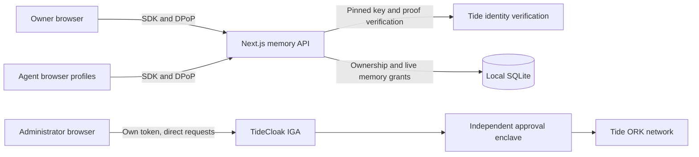

> Current local demo: simulated sign-in and roles, with backend memory access checks. It is **not protected by TideCloak** in simulation mode. The real integration remains separate and blocked at licence/wallet activation.

Public source: [TranPhuocLoc0834/sovereign-memory](https://github.com/TranPhuocLoc0834/sovereign-memory). A demo video has not been recorded or added yet.

[](https://tide.org/tidecloak?utm_source=github&utm_medium=readme&utm_campaign=unlocked)

## Run the local simulation

In PowerShell, from this project directory:

```powershell
npm run build
npm run demo
```

For a fresh checkout, install Node.js 24 or newer, clone the repository, enter its directory and run `npm ci` before building:

```powershell
git clone https://github.com/TranPhuocLoc0834/sovereign-memory.git
cd sovereign-memory
npm ci
npm run build
npm run demo
```

Open [http://localhost:3000](http://localhost:3000). Choose **Demo Owner**, click **Prepare demo memories**, then choose **Study Agent**. In **Agent Access Lab**, choose the study target → HTTP 200; choose the budget target → HTTP 403. As Owner, revoke the Study Agent's read grant in **Memory Vault**, then repeat its study request → HTTP 403. Re-grant explicitly to reset that part of the demo. Preparing samples again does not restore revoked grants.

Choose **Demo Administrator** → **Governance** → **Call admin-only role API** to see HTTP 200; the same call as Owner or an Agent returns 403. Administrator has no automatic memory access. Sign-out invalidates the local session. One browser profile shares an identity across its tabs; use separate profiles for simultaneous actors.

The simulator uses a separate ignored SQLite file and does not require Docker, a Tide adapter or a working licence. Every page labels the simulation; no Tide signatures, DPoP, ORK operations, E2EE or quorum approvals are simulated. This is intentionally a local presentation tool, not secure authentication. Do not publish it or use real data.

Ordinary `npm run start` / `npm run dev` still require real Tide authentication, with no simulation fallback. See [TIDE_INTEGRATION_PLAN.md](TIDE_INTEGRATION_PLAN.md) for the Tide MCP-informed integration map and [DEMO_SCRIPT.md](DEMO_SCRIPT.md) for narration. The remaining setup instructions below apply to **real Tide mode**.

For a two-minute Vietnamese recording walkthrough, see [HUONG_DAN_QUAY_DEMO.md](HUONG_DAN_QUAY_DEMO.md). The final reviewed video belongs in [docs/demo](docs/demo/README.md); no recording has been added yet.

## Project overview

Sovereign Memory is a local memory vault where authenticated AI test clients share selected context while TideCloak governs changes to identity authority.

Built with [TideCloak](https://tide.org/tidecloak?utm_source=github&utm_medium=readme&utm_campaign=unlocked).

### 1. Vision & originality

A study assistant and a finance assistant can use different memories belonging to the same person. Each request is tied to a verified identity, and each memory has an explicit, revocable read grant.

### 2. Trust constraint insight

Ordinary login leaves identity authority concentrated in an administrator. Tide-mode governance can require independent approvals before protected realm role changes take effect. This prototype distinguishes that protection from application permissions and unencrypted storage; it does not claim to remove database-operator trust.

### 3. Value & impact

A student team can share its Friday presentation reminder with a study assistant and its synthetic project budget with a finance assistant. The assistants receive useful context without automatically receiving one another’s grants.

### 4. Why TideCloak matters

The app uses Tide’s SDK, embedded public-key token verification, and DPoP proof validation. Its governance panel sends the administrator’s own authenticated requests directly to TideCloak, stages realm role grants, inspects actual approval requirements, and attempts commits. Approvals occur in Tide’s official enclave. A request must report a threshold of at least two to demonstrate resistance to one administrator.

### 5. Prototype & storytelling

The local dashboard, SQLite vault, backend authorization, revocation, and security tests are implemented. Judges should observe allowed access, a content-free 403, revocation, and a real governed change refused before independent approval. Live Tide login and quorum verification remain pending because real vendor licensing has failed before interactive enrollment.

## Setup

### Requirements

- Node.js **24 or newer** (uses built-in `node:sqlite`).
- Docker Desktop with Linux containers, the WSL 2 backend on Windows, and Compose v2.
- Network access to npm, Tide’s licensing service, and the Tide ORK network.
- A real licence email and explicit acceptance of [Tide’s terms](https://tide.org/legal).

The official [Tide quickstart](https://docs.tide.org/get-started/Tidecloak%20Quickstart) and Tide MCP starter are the basis for this project. The application runs locally; nothing is deployed automatically.

### 1. Install and prepare

```powershell
npm ci
npm run setup:prepare
```

`setup:prepare` creates `.env` only if absent and generates a random master-admin password. Open the ignored `.env` locally, set `TIDE_LICENSE_EMAIL`, and set `TIDE_TERMS_ACCEPTED=yes` only after personally accepting the terms. Never paste its password into source code. Existing `.env` files are preserved.

For this workspace, the owner’s supplied licence email and explicit acceptance have already been saved in `.env`. Neither the file nor its password is tracked.

### 2. Make Docker ready

If Docker is absent, install [Docker Desktop for Windows](https://docs.docker.com/desktop/setup/install/windows-install/), select WSL 2, restart if requested, then open Docker Desktop. Wait until the engine is running and use a new PowerShell window:

```powershell
docker version
docker compose version
docker info
npm run setup:check
```

Do not run WSL installation, alter virtualization settings, or accept Docker’s licence without the machine owner completing those steps. No Docker installation is performed by the project.

### 3. Bootstrap real TideCloak

```powershell
npm run setup:tide
```

This Windows-friendly helper uses the official `tideorg/tidecloak-dev:latest` image, binds port 8080 to loopback, imports Tide’s complete realm template, licenses the realm, and enables Tide-mode IGA. It creates synthetic named test accounts and application roles. It never fabricates an adapter or signs a MultiAdmin approval from the application server.

The helper prints a private first-administrator invitation and waits for interactive Tide account linking. Keep the process running. Before completing enrollment, choose whether to brand the login screen and what profile fields to collect. The default application needs no email address for its users. Do not record or commit invitation links.

After linking, the helper signs IdP settings, grants the first administrator role last, and exports the **real** public adapter to ignored `data/tidecloak.json`. It prints invitations for the owner, Study Agent, Finance Agent, and two additional administrator candidates. Use each invitation in its intended browser profile. For an interrupted first-admin enrollment, rerun `setup:tide` to resume. If a realm already exists without this helper’s resume state, it stops without modifying it. Complete it using Tide’s console, then use `npm run setup:export`.

The shipped Bash bootstrap remains available as `npm run init`, but the Node helper is recommended on Windows because it does not require jq or Git Bash.

### 4. Start the application

```powershell
npm run dev
```

Open [http://localhost:3000](http://localhost:3000). Sign in with Tide. The signed-in session must also pass the backend’s signature and DPoP checks before data appears. Without an adapter the app displays its setup state and sensitive APIs return 401.

The health panel distinguishes a reachable server from completed realm setup. A green **TideCloak server** badge does not mean login or governance is verified. In this workspace, the server is online but free-tier wallet finalization returned 500, then 403 on recovery. See [TIDE_SETUP_BLOCKER.md](TIDE_SETUP_BLOCKER.md); restarting Docker or repeatedly creating realms does not resolve the observed activation failure.

For a production build:

```powershell
npm run build
npm run start
```

### 5. Establish genuinely independent governance

In [the local Tide console](http://localhost:8080/realms/sovereign-memory/tide-console/), sign in as `governance-admin-a`. Through the console, grant the `realm-management` client role `tide-realm-admin` to the B and C candidates, approving the real change requests through Tide’s enclave as required. Have independent reviewers control these accounts and their Tide credentials.

Do not assume two administrators mean two required approvals: documented thresholds can still be one. The live MultiAdmin gate comes from the signed administrator policy; adding administrators may require a `REGEN_ADMIN_POLICY` change approved through Tide’s console before the threshold changes. Stage a protected role grant, inspect the **actual** request’s `threshold`, and proceed with the no-single-administrator demonstration only if it is at least two and `iga.attestor=tide`, `isIGAEnabled=true`. If the running build does not support this, report it rather than changing to a fake counter or Tideless mode.

## Demo

1. Open three separate browser profiles for `memory-owner`, `study-agent`, and `finance-agent`. Each must complete its own real Tide sign-in. An additional administrator profile demonstrates unauthorized agent access.
2. Sign in as both agents once so their verified subjects register in the app.
3. As owner, click **Prepare demo memories**. The two synthetic memories are created, with matching grants for already registered agents. Inspect or explicitly grant each agent access in **Memory Vault**. Copy both memory UUIDs.
4. In the Study Agent’s **Agent Access Lab**, request the study UUID → 200/ALLOWED with the reminder. Request the finance UUID → 403/DENIED with no memory content.
5. In the Finance Agent’s session, request the finance UUID → 200. A non-agent account’s request → 403.
6. As owner, revoke the Study Agent grant. Repeat its study request → 403. Re-grant explicitly to repeat the demo. Preparing the samples again never silently restores revoked access.
7. In the administrator session’s **Governance** page, click **Inspect live governance**, then stage a role grant for an existing target subject. Confirm HTTP 202 and the real pending request. For a threshold ≥ 2, attempt a commit before sufficient approval and show the returned HTTP 412, inspecting any dependency reason.
8. Complete the independently controlled approvals in Tide’s official console. Refresh this app and confirm the request applied, with the new role visible after fresh authentication. Use **Security Logs** for app memory events; Tide’s console retains the governance audit.

See [DEMO_SCRIPT.md](DEMO_SCRIPT.md) for the two-minute narration and [SECURITY.md](SECURITY.md) for the trust boundaries.

## Architecture



Next.js 16 / React 19 / TypeScript / Tailwind 4 / Lucide; Node SQLite; Zod input validation; JOSE Ed25519 verification. Tide’s copied relay, CSP, rewrite, callback, and provider form the integration foundation. Webpack is intentional, following Tide’s SDK guidance.

In real Tide mode, agent registry entries come from verified token subjects and precisely scoped realm roles. In simulation, the server fixes claims from the selected fixture session. In both modes, passing an agent ID to the memory API cannot change the caller; owners can manage only their own records and administrators have no automatic plaintext read privilege.

### API surface

| Route | Purpose |
| --- | --- |
| `GET /api/health` | Public app/realm reachability; no user data |
| `GET /api/config` | Allowlisted public adapter only, or 503 |
| `GET /api/session` | Verified principal and scoped workspace |
| `POST /api/memories` | Owner creates memory |
| `POST /api/memories/{id}/permissions` | Owner grants/revokes agent reads |
| `POST /api/access` | Current authenticated agent requests memory |
| `POST /api/seed` | Owner creates synthetic examples idempotently |
| `GET /api/logs` | Caller’s events and events on owned memories |

Every sensitive endpoint passes through signature, issuer, authorized-party, expiry, subject and DPoP verification. Public configuration is restricted to a public client and public signing keys. No master token is sent to the browser. The direct governance calls use the current administrator’s identity, not a master credential proxy.

## Verification

```powershell
npm test
npm run typecheck
npm run lint
npm run build
npm run verify:live
```

`npm test` runs application security tests using generated local Ed25519 and proof keys against the actual route handlers and SQLite. **These are not real Tide login or governance tests.** `verify:live` is a read-only HTTP smoke check against the running app. It checks 401s and the served DPoP relay, and reports whether TideCloak is configured. It does not claim an interactive login succeeded.

The official diagnostic is available after downloading the Tide MCP pack:

```bash
bash .tide-pack/templates/shared/tide-doctor.sh --app . --check --url http://localhost:3000
```

See [VERIFICATION.md](VERIFICATION.md) for observed results and outstanding live verification. The current activation failure is recorded in [TIDE_SETUP_BLOCKER.md](TIDE_SETUP_BLOCKER.md); do not delete the partial realm or repeatedly run its initial setup endpoint.

## Security limitations

- SQLite stores plaintext synthetic memories. A database or application host operator can read or alter them. This is **not** cryptographically sovereign memory storage.
- App grants and audit logs are ordinary application/database controls. Tide QEA does not automatically protect those rows or deployed code.
- Live Tide authentication and governance remain unverified until the realm exists and enrollment completes. A configured adapter is not proof of a completed login.
- Local memory revocation applies to subsequent requests immediately. Role changes in Tide require token refresh/new login; existing access tokens can remain valid until expiry.
- Previously disclosed plaintext cannot be erased by revocation. Audit logs are scoped and content-free, but not tamper-proof against a database operator.
- The app is intended for one local deployment with one SQLite file. No public deployment, rate-limiting gateway, backups, or production browser hardening is claimed. Forwarded headers are not trusted.
- No LLM, RAG, vector database, or custom Forseti contract is included. Identity/roles are simulated only in the explicit local demo mode; those results must never be presented as real Tide protection.

## Submission

The README overview follows the five official headings retrieved from the [challenge](https://tide.org/unlocked/) on 22 October 2026 and stays under 300 words. Public source is published at [TranPhuocLoc0834/sovereign-memory](https://github.com/TranPhuocLoc0834/sovereign-memory). The submission still requires a real two-minute MP4 under 100 MB. No video has been recorded or uploaded; a simulated recording must not be presented as proof of real Tide protection.

Use [SUBMISSION_CHECKLIST.md](SUBMISSION_CHECKLIST.md). Complete live login and quorum verification before claiming challenge acceptance, recording the demonstration, or publishing the submission.
